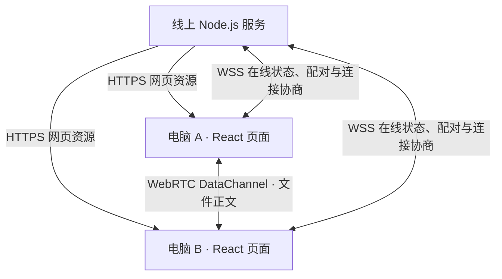

# 局域网快传（lan-send）方案与技术设计

记录日期：2026-11-17。

本文是“局域网快传”的唯一方案文档，已从 agent-tools 迁移到独立项目 `lan-send/`。第 1—8 节记录已确认的产品范围与架构边界，第 9 节起是实施前细化的工程设计建议；工程参数可以根据验证调整，不改变已确认的产品范围。文中的能力是设计目标，不代表已经通过验证；当前实现范围与验收边界见 [README](../../../README.md)。

## 1. 产品目标与首版范围

用户在两台电脑上打开同一个网站，找到对方并确认接收后，通过浏览器直接传递文件，无需安装客户端或启动本地服务。

第一版面向局域网内的电脑互传场景，保留轻量线上服务完成设备发现、配对和连接协商。文件正文不上传到线上服务器，也不通过云端中继。

| 项目 | 已确定的范围 |
| --- | --- |
| 终端 | 电脑端；手机和平板不纳入第一版 |
| 浏览器目标 | Chromium 内核浏览器，不按品牌设置白名单；Safari、Firefox 不在首版范围 |
| 文件规模 | 必须支持单个 10G 文件；第 11 节建议同时覆盖 10 GB 和 10 GiB 验收，不由此预设硬性大小上限 |
| 身份与登录 | 无需注册登录；生成临时设备名，用户可修改 |
| 设备发现 | 按同一公网出口自动展示候选设备，不把候选列表当作身份或网络归属证明 |
| 配对兜底 | 使用配对码，不提供二维码 |
| 文件组织 | 支持多个文件排队、逐个传输；不做文件夹传输和一对多广播 |
| 接收操作 | 单文件确认接收；多文件确认整批清单并一次授权目标文件夹，可以拒收 |
| 文件保存 | 单文件选择保存位置；多文件一次选择目标文件夹，按已确认清单自动依次保存，不逐个弹窗 |
| 状态展示 | 明确显示传输、校验、保存和结果确认阶段；传输结束后切换状态，不把主进度卡在 100% |
| 暂停与续传 | 页面保持打开时支持暂停、继续，以及短暂断网后重新连接并续传 |
| 续传非目标 | 刷新、关闭页面或重启浏览器后的续传不纳入首版承诺 |
| 网络范围 | 以局域网场景为主；不同局域网的设备经配对后，只要能直接连接也允许传输 |
| 取消操作 | 双方都可取消，明确同步取消结果并妥善处理未完成文件 |
| 连接失败 | 提示失败或不可达，允许重试，不自动切换到云端文件中继 |

浏览器支持范围按 Chromium 内核和必要接口定义，不收窄为 Chrome、Edge 品牌白名单。页面检测 WebRTC、文件写入等必要能力，版本过旧或缺少能力时提示升级或更换兼容浏览器。具体最低版本和操作系统组合通过后续验证确定。

## 2. 技术选型

| 部分 | 选型与职责 |
| --- | --- |
| 前端 | React，使用 Node.js 工具链开发和构建，页面运行在浏览器中 |
| 后端 | Node.js，提供网页资源、在线设备状态、配对和连接协商服务 |
| 网页访问 | 对外使用 HTTPS |
| 协调通道 | 浏览器与后端通过 WebSocket 通信，对外使用 WSS |
| 文件通道 | WebRTC DataChannel，在两个浏览器之间直接传输文件 |
| 部署交付 | Docker 镜像；首版按单容器、前后端同源组织 |

Node.js 版本、包管理器、是否使用 TypeScript、前端构建工具和后端框架不属于需要用户逐项确认的产品问题。本轮工程建议见第 9 节；确切依赖版本和镜像版本在实施时根据维护状态固定。分块大小、校验算法和流控参数同属工程细节，根据第 11 节的初始设计验证和调整。

## 3. 架构与数据边界

线上服务负责让两端相互找到，并转交建立直接连接所需的信息。这些连接协商信息通常称为“信令”。WebRTC 通道建立后，文件正文通过浏览器之间的加密数据通道发送。

服务端不接收、存储或中继文件正文。第一版不配置 TURN 文件中继，也不提供上传到云存储再下载的路径。Docker 容器运行网页和协调服务，文件传输不经过容器。

本方案保留线上协调服务，因此不把首次访问、设备发现和配对的完全离线使用作为首版目标。

## 4. 用户操作流程

1. 两台电脑打开网站，通过必要能力检测后连接协调服务；无需注册登录，页面生成可修改的临时设备名。
2. 页面展示同一公网出口下的候选设备；找不到对方时，通过配对码建立配对关系。配对不要求两端公网出口一致。
3. 发送方选择目标设备和一个或多个文件，生成当前批次的固定清单，展示文件数量、名称和总大小。
4. 接收方查看请求，可以拒绝。单文件选择保存位置；多文件点击“接收整批并选择文件夹”，一次选择目标文件夹并完成授权，确认整批清单。取消选择不视为同意接收。
5. 两端通过线上服务交换连接信息，尝试建立 WebRTC 直接连接。
6. 连接成功后逐个传输文件，接收端逐块校验和写入。多文件在同一批次授权下自动依次保存，不再为每个文件请求接收确认或弹出保存选择器。
7. 页面保持打开时，用户可暂停、继续或取消；短暂断网后尝试重新连接，从接收端已确认的位置继续。批次清单变化或目录权限被撤销时，暂停并明确请求处理，不能偷偷扩展授权。
8. 每个文件完成正文传输后，主状态依次切换为“校验中”“保存中”；发送方需要时显示“等待接收方保存确认”。校验和文件提交成功后显示“已完成”，再自动处理批次下一项。校验、保存或确认阶段不以静止的 100% 代替状态。

候选设备分组只帮助用户找到对方，不能替代接收确认。临时设备名只是展示名称，不代表经过验证的身份。配对码的长度、有效期、使用次数和尝试限制，在详细设计中确定。

双方都可以取消传输，接收方也可以在开始前拒收。取消后停止继续发送文件数据、向双方明确显示取消结果，妥善处理未完成文件或未提交写入，不能显示为接收完成。具体队列取消范围和未完成文件处理方式属于后续交互与写入设计，不因此引入任意删除用户文件的行为。

## 5. 文件传输与保存

首版必须支持单个 10G 文件，采用用户选择保存位置、分块接收和写入的路线，不以整文件内存缓存后再下载作为大文件保存方案。10G 是必须覆盖的文件规模目标，不直接等同于硬性大小上限；第 11 节以同时覆盖 10 GB 和 10 GiB 作为保守验收建议。

- **分块处理**：逐块读取和传输，不把整份大文件一次性加载到内存；内存工作集受分块和缓冲策略控制。
- **完整性校验**：接收端确认数据是否完整，不能仅因发送方已经发送完毕就认定接收完成。
- **流控**：根据通道和接收端的处理能力安排发送，避免待发送或待保存的数据持续堆积。
- **进度与结果**：区分发送队列、接收确认和最终文件保存状态；主界面从传输百分比切换为明确的校验、保存与等待确认状态，显示阶段已用时间，不用静止的 100% 或伪造的百分比代表仍未结束的处理。写入失败、磁盘空间不足或用户取消不能显示为成功。
- **暂停与继续**：双方页面保持打开且文件引用、写入状态仍有效时，支持暂停后继续。
- **断线重连**：短暂断网后重新建立连接，核对传输记录和接收端已确认的连续位置，再继续传输，不能根据发送方已入队的字节数跳过数据。
- **恢复边界**：刷新、关闭页面或重启浏览器后的续传不纳入首版承诺，不增加跨重启恢复所需的持久传输状态体系。
- **完成判定**：全部数据校验通过、总长度一致，且接收端文件写入和关闭成功后，才确认完成。分块写入确认不等同于最终文件已经提交完成。

文件保存统一面向具备必要 File System Access API 能力的电脑端 Chromium 浏览器，不再为 Safari 或 Firefox 设计另一套保存适配。接口缺失、权限被拒绝或用户取消保存选择时，明确提示并停止对应接收流程。

具体分块大小、校验算法、流控阈值、重连策略、未完成文件处理和最大文件大小，由详细设计确定并实测。10G 文件的完整性、持续写入和内存占用必须纳入真实双设备验收，不能把架构选择当作已通过验证的证据。

此前的本地 LAN DROP 是 Node.js HTTP 文件服务，可借鉴其分块校验和进度确认思路；它不等于本网站已经具备 WebRTC 传输或浏览器兼容性验证。

## 6. Docker 部署基线

使用多阶段构建生成 Docker 镜像：构建阶段安装构建所需依赖并生成 React 静态资源，运行阶段保留后端程序、生产依赖和静态资源。

首版由一个 Node.js 服务提供前端静态资源和 WebSocket 协调接口，使前后端使用同一域名。对外入口使用 HTTPS 和 WSS；证书管理位置、反向代理软件和实际部署平台尚未确定。

本次仅确定镜像交付和部署结构，不表示已经制作镜像、开放服务或执行上线。

## 7. 网络边界

WebRTC 直连不等同于局域网直连。WebRTC 也可以跨互联网直接连接，禁用 TURN 中继本身不能证明文件只在物理局域网内流动。已确认允许不同局域网的用户通过配对码找到对方后直接传输，只要两端能够建立 WebRTC 直接连接；不以相同公网 IP 作为配对和传输的硬性要求。

产品定位是“面向局域网场景、允许跨网络直连的浏览器文件互传工具”，不承诺文件绝对只走局域网，也不承诺所有跨网络连接均能成功。

候选设备按同一公网出口自动分组展示。但同一公网 IP 不一定代表同一局域网，公司网络、共享出口下可能出现不熟悉的设备；VPN、代理和运营商网络也可能影响分组。设备发现不能替代配对和接收确认。分组使用的地址来源和反向代理信任边界由详细设计确定，不能直接信任客户端自行声明的来源地址。

同一 Wi-Fi 下也可能存在设备隔离或网络策略限制，浏览器权限和设备设置也会影响直接连接。配对成功只代表双方已建立配对关系，不代表网络通道一定可达。

是否使用 STUN、允许哪些连接候选、如何观察和验证实际传输路径，需要在详细设计和双设备测试中确定。STUN 用于辅助获取连接地址，不承担文件正文中继，不应与 TURN 混淆。

## 8. 后续详细设计与验收

已确认的产品约定不再重复作为待选项。以下内容按其影响分别处理：

| 类别 | 后续内容 | 处理方式 |
| --- | --- | --- |
| 项目归属 | 局域网快传，项目根目录 `lan-send/` | 已确定；本方案保存在当前项目，原位置不保留副本 |
| 工具链 | Node.js 版本、包管理器、语言、构建工具和后端框架 | 按已确认需求由实施阶段选择 |
| 浏览器验收 | Chromium 最低版本、操作系统组合、能力检测与提示 | 根据必要接口和实测形成支持矩阵，不设置品牌白名单 |
| 发现与配对细节 | 公网出口识别、设备名规则、配对码生命周期和尝试限制 | 在自动候选发现、临时可改名和配对码兜底的范围内设计 |
| 文件协议 | 10G 验收字节数、分块与校验、流控、重连和取消语义 | 初始工程设计见第 11—13 节；不重新纳入刷新或关闭页面后的续传 |
| 连接策略 | STUN 配置、连接候选、失败提示和实际路径验证 | 在允许跨网络直连、禁止文件中继的边界内设计 |
| 上线资料 | 部署服务器、域名、现有反向代理与 HTTPS 配置 | 准备上线时由用户提供或确认，不阻塞本地详细设计 |
| 部署细节 | 基础镜像、服务配置和运行方式 | 按单容器、前后端同源及 HTTPS/WSS 入口设计 |

实施前优先验证两个风险点：两台真实电脑在目标浏览器和网络组合下的直接连接，以及单个 10G 文件的接收、校验、持续写入和最终保存。后续验收还应覆盖多文件顺序队列、暂停继续、短暂断网后的续传、拒收和取消，并确认这些路径不会把未完成文件显示为成功。具体速度和内存指标依据设计及实测补充，不预先承诺跑满网络带宽。

## 9. 工程结构与职责建议

以下是本轮工程建议，不代表已创建代码、依赖、配置或镜像。

| 部分 | 建议 | 原因与边界 |
| --- | --- | --- |
| 语言 | 前后端统一 TypeScript | 共享消息类型，降低信令和传输协议字段不一致的风险；运行时仍须校验外部输入 |
| 前端构建 | React + Vite | 前端构建成静态资源；生产环境不运行 Vite 开发服务器 |
| 后端 | Node.js 原生 HTTP 服务 + `ws` | 只提供静态资源、少量状态接口和 WebSocket 协调，不引入完整业务框架 |
| 依赖组织 | npm workspaces，单一锁文件 | 前端、后端、协议定义一起构建和校验；部署时只保留生产所需产物 |
| 状态存储 | 单进程内存 | 首版无需数据库或 Redis；设备、配对码和配对关系都有生命周期 |
| 运行时 | 选用实施时仍受维护的 Node.js LTS | 固定依赖、运行时和基础镜像版本，不依赖浮动 `latest` |

建议逻辑目录为 `apps/web`、`apps/server`、`packages/protocol` 和现有 `docs`。这是目录规划，本轮不创建这些代码目录。

前端把页面展示、在线协调、WebRTC 连接、传输状态机、校验 Worker、文件写入分别组织。React 只接收进度快照，不保存二进制块，不逐帧触发渲染；读文件、校验和发送也不能依赖组件重新渲染才推进。页面状态可先按每秒约 4 次刷新，终态立即更新。

后端划分在线设备表、配对码表、配对关系表、信令转发、限流与过期清理。它不具有上传文件接口，不把文件正文塞入 WebSocket；浏览器使用原生 WebSocket，`ws` 只用于 Node.js 服务端。

## 10. 在线状态、发现与配对

### 10.1 临时身份与来源地址

每个标签页建立自己的临时会话。服务器生成不可预测的 `peerId` 和独立的恢复凭据，后者只留在页面内存中并通过 WSS 传递。设备名称是可修改的展示字段，不能作为授权依据；知道 `peerId` 也不能冒充该设备。

WebSocket 断开后，设备先标记离线；建议保留 2 分钟恢复宽限，凭恢复凭据重新绑定到新连接，旧连接随即失效。页面刷新后创建新会话，不设计持久登录，也不把恢复凭据写入 URL 或日志。

直连部署读取连接来源地址；经过反向代理时，只在请求确实来自配置的可信代理时解析转发头。统一处理 IPv4、IPv4 映射地址和 IPv6，不能把所有代理后的用户误分到代理服务器的同一个地址组。具体 IPv6 分组粒度先采用规范化后的完整地址，发现不到同网设备时使用已确定的配对码兜底。

候选列表只展示设备名称、临时标识和在线状态，不展示对方 IP、文件清单或本地路径。设备名按纯文本显示、限制长度。候选列表有分页或条数上限，不能对单个共享出口无限广播设备变化。

### 10.2 配对码与接收确认

配对码只用于定位在线设备，不能代替接收确认，也不是文件加密密钥。建议初始规则如下，均为可调工程默认值：

| 参数 | 初始建议 |
| --- | --- |
| 形式 | 8 位数字，保留前导零，使用密码学安全随机源生成并检查冲突 |
| 有效期 | 5 分钟；重新生成后旧码失效 |
| 使用 | 一次成功配对后失效；申请和接受过程串行处理，防止同时消费 |
| 尝试限制 | 每个临时会话每分钟最多 5 次；来源 IP 另设较宽的总量限制，避免共享出口被一人轻易拖累 |
| 数据保存 | 仅内存，不记录明文配对码、恢复凭据或完整信令 |

从候选设备发起和输入配对码发起最终进入同一邀请流程。邀请只允许发给在线目标，目标同一时间只处理有限个待确认请求，拒绝或超时必须回告发送方。

为了让接收方在建立连接前看清请求，初始邀请通过 WSS 携带待确认批次的文件数量、总大小和文件清单等必要元数据。清单绑定 `queueId`、版本和摘要；大清单分段传递，每段和整个清单都有限额，接收完整并验证摘要后才能显示确认入口。它不携带文件正文或本地绝对路径，文件名等元数据不写入常规日志。

单文件仍由接收方选择保存位置。多文件点击“接收整批并选择文件夹”，在本次用户操作中调用目录选择器并完成读写授权，成功后接受这一批次并开始 WebRTC 协商。后续文件只要属于已确认清单、目录权限仍有效，就自动依次接收和保存，不再逐个询问。追加、替换文件或改变清单版本要按新批次重新确认，不能借已有目录授权自动接收对方后续任意文件。

### 10.3 信令接口与权限

建议使用同源 `/ws` 连接。消息带协议版本、消息类型和请求 ID；属于配对的消息还带 `pairId` 和协商代次。会话注册、在线快照、设备改名、配对码、邀请接受或拒绝、offer/answer/ICE 候选及状态通知采用明确的消息类型。

服务器根据当前连接绑定的身份校验消息，不能根据客户端自己填写的发送者 ID 转发。只有邀请已被接受的两端才能互传该配对的信令；协商代次用于拒绝旧连接的迟到消息。重试消息必须有明确的幂等行为，不能重复创建配对。

初始建议限制单条信令为 64 KiB，限制字段长度、消息频率、候选数量、待确认邀请和总连接数，并关闭 WebSocket 消息压缩。浏览器 WebSocket 握手检查配置的站点 Origin；这能阻止普通跨站网页使用该接口，但不作为阻止自定义客户端的身份认证手段。

## 11. WebRTC 通道与文件协议

### 11.1 连接建立与网络策略

每对设备维护一个 PeerConnection。首版建议每个标签页同一时刻只执行一个活动文件，多个文件进入顺序队列；其他设备同时发起时返回忙或等待，不并发占用同一文件写入流。两边同时发起时，以服务器分配的稳定角色确定 offer 发起方，避免重复协商；相反方向的请求等待当前活动文件结束。

使用一个可靠、有序的 DataChannel 承载小型控制消息和二进制帧，不配置部分可靠传输。单通道便于保持协议顺序；控制响应的延迟通过限制发送缓冲控制，而不是假定控制消息能越过已经排队的数据。

保留本机地址候选，可选配置 STUN 辅助获取直连地址，不配置 TURN。STUN 地址由部署配置提供，不硬编码某家公共服务；没有 STUN 时仍尝试本地连接，但跨网络可达性不作保证。客户端拒绝或终止选中 relay 候选的路径，确保不会误启文件中继。

连接状态通过 PeerConnection、ICE 状态和 `getStats()` 观察。界面可显示“直接连接”“正在重连”等状态；候选类型只能作为诊断信息，不能仅据 `host` 候选就标成“已证明只走局域网”。浏览器或系统的本地网络权限提示需要纳入实际兼容性验证。

### 11.2 文件身份、块与帧

每个队列有 `queueId` 和不可变清单版本，每个文件有不可复用的 `transferId`。批次清单记录允许接收的文件标识、名称、大小、数量及协议参数，并计算摘要；每份文件清单固定名称、字节长度、最后修改时间和协议参数，也计算摘要。恢复时必须匹配原批次、文件和授权，清单摘要不替代文件正文校验。

接收方保存由原文件名到实际目标名的映射；本地冲突改名不改变源文件身份，也不要求重新接收确认。目录句柄和目标路径只留在接收页面内，发送方不取得本地目录路径。

建议初始参数如下，验证后可在协议版本内按协商规则调整：

| 参数 | 初始设计 |
| --- | --- |
| 大文件验收 | 同时覆盖 10 GB，即 10,000,000,000 字节，以及 10 GiB，即 10,737,418,240 字节；以后者作为保守的大文件目标，不由此设置硬性上限 |
| 校验块 | 1 MiB，最后一块允许不足 |
| DataChannel 消息 | 每条含头部不超过 16 KiB，并服从实际协商的 `maxMessageSize`；协商结果不能容纳必要头部时拒绝传输 |
| 未确认窗口 | 最多 4 个校验块，即默认最多 4 MiB 文件载荷；发送端读前缓冲也计入预算 |
| 通道高低水位 | 发送缓冲约 1 MiB 时暂停入队，下降至约 256 KiB 后继续；恢复前重查通道状态和接收端额度 |
| 数值编码 | 文件长度、累计偏移量使用安全整数或明确的 64 位编码，不使用 32 位位运算计算大文件偏移 |

每个二进制帧关联 `transferId`、连接代次、块序号、块内偏移和载荷长度。接收方同时检查范围、顺序和当前授权状态；一个字段合法不代表整帧合法。控制消息和二进制帧都受长度上限约束，不把大文件一次性传给 `send()`。

### 11.3 校验与写入确认

发送方逐块读取源文件，在 Worker 中计算该块 SHA-256，再拆成小帧发送。接收方按顺序重组当前块、重新计算 SHA-256，匹配后串行写入当前文件流，等待本次写入成功后推进确认位置。异步消息处理必须经过串行写入队列，不能让多个消息回调并发写同一个位置。

累计完整性采用滚动校验链：初始值绑定协议版本和不可变文件清单摘要，下一值包含上一个链值、当前块的 SHA-256、块序号和块长度。这些字段使用约定的定长字节编码，避免字符串拼接歧义。链值不是普通的整文件 SHA-256，不向用户或外部工具冒充整文件 SHA-256。

每次 ACK 返回已确认的连续偏移、下一块序号、对应链值及接收额度。发送方只释放已经确认的数据；确认丢失时先查询接收方状态，不能直接把同一块追加第二遍。重复块只有在身份、位置和已有哈希一致时才返回已有确认；冲突、跳块、越界或校验失败不得推进进度。

通道缓冲和接收额度是两层独立限制：即使 `bufferedAmount` 降低，只要接收端仍在校验或写入、没有可用额度，也不能继续堆积数据。接收端必须独立执行额度和帧长度上限，超过上限即终止当前文件，不能按对端声明的文件总长度一次性分配内存。应用层控制块数量和事件队列；这不等于能精确限制浏览器、操作系统或网络栈的全部内存。

### 11.4 建议消息语义

| 消息 | 用途 |
| --- | --- |
| `hello` | 校验协议版本、配对和连接代次，协商消息与窗口上限 |
| `queue.offer` / `queue.accept` / `queue.reject` | 展示并绑定整批清单；多文件取得一次目录授权后接受整批，不逐个重复确认 |
| `file.offer` / `file.accept` / `file.reject` | 单文件正常确认；已授权批次中的文件自动核对清单、权限和目标名，只有异常才暂停处理 |
| `file.ready` | 双方确认文件清单摘要、块参数、授权和起始位置一致后才发送正文 |
| `chunk.begin`、二进制帧、`chunk.end` | 传递块元数据、正文及块边界；接收端校验后写入 |
| `chunk.ack` / `file.status` | 连续确认、接收额度及状态查询；状态包含真实阶段、阶段开始时间、已确认字节和已完成文件数 |
| `file.pause` / `file.resume` | 暂停原因和恢复意图；不能清除对方仍保持的暂停状态 |
| `resume.offer` / `resume.accept` | 新连接上核对断点、链值和当前文件授权 |
| `file.finish` / `file.complete` | 先请求校验并提交文件，提交成功后确认完成 |
| `file.cancel` / `file.error` | 终止当前文件并返回明确结果，不能当成完成确认 |

初始邀请已经展示并授权当前文件或整批清单，通道上的 offer 只复核同一份授权。多文件同一批次中，前一文件保存成功后自动准备下一项；不得重新弹接收确认或保存选择器。清单外的文件、版本或摘要不一致的文件一律停止接收，不能通过自动确认绕过批次授权。

## 12. 接收保存、队列与状态机

### 12.1 批次授权与保存位置

单文件接收使用保存选择器。多文件接收使用 `showDirectoryPicker` 请求目标目录的读写权限：接收方点击“接收整批并选择文件夹”，在该用户操作中选择一次目录并完成浏览器要求的授权，后续文件通过同一个目录句柄自动创建、写入和提交，不逐个弹窗。目录选择能力缺失时明确提示，不静默降级为逐个授权保存。

选择接收文件夹只是确定保存位置，仍然不支持发送文件夹、扫描源目录或重建目录树。浏览器实际授予的是目录读写能力；应用仅用它处理当前已确认清单的目标文件，不遍历、读取或上传目录内的无关文件。目录句柄只在当前页面内存保留，不增加刷新、关闭页面后的续传能力。

自动生成的目标名要清理路径分隔符、特殊路径和非法字符。目录中已有同名文件，或者当前批次内部重名时，自动增加后缀并保留原文件，在结果列表显示实际保存名。接收端使用单一写入队列检查冲突，遇到无法安全处理的写入冲突则暂停该项，不用覆盖解决冲突；外部进程同时修改目标文件的行为纳入验证。单文件用户在系统保存对话框中明确选择覆盖，仍按其明确选择处理。

权限在批次中被撤销时，暂停队列并显示“需要重新授权文件夹”，由用户点击后重新请求权限，不能在后台反复弹窗。重新授权须核对原目录；不能未经说明把剩余文件写到另一个位置。新增文件必须按新清单确认，目录权限仍有效也不能扩大当前批次的接收范围。

使用 FileSystemWritableFileStream 逐块写入。它通常先修改临时内容，成功关闭流后才把变更提交到最终文件；因此 `write()` 返回成功不等于最终文件已保存，也不是浏览器暴露了逐块 `fsync` 能力。临时写入可能占用额外磁盘空间，必须处理写入和关闭时的空间不足错误，不能只根据网页存储配额估算目标磁盘可用容量。

### 12.2 用户可见状态与进度

用户始终能看到当前正在做什么。传输百分比只用于实际传输阶段；正文传完后，主进度区切换为阶段状态、活动指示和已用时间，不让用户面对一个静止的 100%。

| 阶段 | 接收方展示 | 发送方展示 | 进度规则 |
| --- | --- | --- | --- |
| 等待接收 | 等待确认清单和选择保存位置 | 等待对方接收 | 不显示传输百分比 |
| 传输中 | 正在接收第 n/N 个文件 | 正在传输第 n/N 个文件 | 按接收端已确认字节显示百分比、已传大小、速度和估计剩余时间 |
| 校验中 | 正在核对文件完整性 | 对方正在校验文件 | 主进度改为“校验中”和阶段已用时间；确有可计数工作时才显示真实处理量 |
| 保存中 | 正在保存文件 | 对方正在保存文件 | 显示“保存中”和阶段已用时间；没有可用的文件提交进度接口时使用活动指示，不编造百分比或倒计时 |
| 等待确认 | 本地实际保存成功则显示该文件已保存 | 等待接收方保存确认 | 发送方未收到最终确认前不显示已完成，也不继续停在传输 100% |
| 已完成 | 已保存，可查看实际文件名 | 对方已保存 | 收到确定结果后显示完成标记；若展示总进度，只有整批所有文件最终提交成功才显示成功的 100% |
| 暂停、重连或失败 | 显示具体原因和可用操作 | 显示对应状态或结果未确认 | 不伪造进度推进，不把失败、取消计入成功文件数 |

校验随分块传输进行，末尾只做协议要求的最终一致性检查，不为了展示阶段而重新读取整份 10G 文件或人为等待。阶段可以很短，界面应及时进入真实的下一个状态。

接收端进入校验和保存阶段时立即发送状态更新；耗时阶段周期性报告当前状态，发送端可主动查询。阶段已用时由接收端报告，发送端以收到状态时的本地计时继续显示，不能直接相减两台设备的墙钟时间。批次摘要同时展示“已保存 n/N 个文件”和当前文件阶段，某个文件的数据发完不能把它先计为已保存。批次因部分失败或取消而结束时，明确显示“部分完成”或“已结束”及成功、失败、取消数量，不用未满 100% 暗示任务仍在运行。

保存时间较长时，例如超过建议的 15 秒，显示“仍在保存文件，请保持页面打开”及真实已用时间。`close()` 没有返回时不能因提示阈值到达就断言失败、强行重传或报成功；响应长时间缺失时显示“正在确认保存结果”并提供状态查询，浏览器错误、通道状态和实际提交结果才决定最终结果。

### 12.3 状态机与取消优先级

| 状态 | 含义与退出条件 |
| --- | --- |
| `queued` / `awaiting-accept` | 排队或等待当前文件、整批清单的接收与保存授权 |
| `awaiting-permission` | 当前批次目录权限失效，等待用户重新授权；不是逐文件的常规步骤 |
| `connecting` / `ready` | 协商连接、复核文件与起始位置 |
| `transferring` | 在双方均未暂停且有接收额度时发送 |
| `pausing` / `paused` | 停止追加新数据，完成或丢弃未确认尾部后确认暂停；保留有效写入流 |
| `reconnecting` | 冻结旧连接代次，等待连接及断点核对 |
| `verifying` | 核对长度、块数和链值；界面明确显示校验阶段 |
| `saving` | 关闭写入流并提交文件；界面明确显示保存阶段和已用时间 |
| `awaiting-confirmation` | 发送端等待最终保存确认，主动查询时不得重复写文件 |
| `completed` | 接收端提交成功；发送端取得完成确认；更新批次已保存计数后才自动处理下一项 |
| `rejected` / `cancelled` / `failed` | 各自独立的终态，不能合并为完成 |

双方的暂停标记独立保存，任一方仍暂停就不继续发送。暂停可以允许已经在途的有限数据处理到下一个安全块边界，界面先显示“正在暂停”。

取消默认针对当前文件，保留队列但暂停推进；用户可另行取消整个队列。拒绝整批请求则不接收该批任何正文；接受整批后不再把后续每个文件当作新的确认请求。终态和控制请求由同一个状态机串行裁决，取消后释放缓冲、文件引用和未提交写入；使用流的中止机制，不为了清理而任意删除本地文件。批量创建的未完成目标只按能够确认的本批次归属处理，不能删除原来已有的文件。

一旦最终提交已经成功，就不能把迟到的取消变成“已撤回文件”。提交与取消交错时，以实际提交结果为准，明确报告已保存或已取消；不能在已经保存后自动删除文件。若无法确认对端是否完成，显示“对端保存结果未确认”，不能盲目重传或报成功。

## 13. 断线重连与续传

### 13.1 把协调连接和文件通道分开处理

- 只有 WebSocket 断开、WebRTC 仍可用：文件继续直接传输，后台恢复在线协调，不因在线列表暂时失联而强行中断文件。
- ICE 暂时断开：暂停新增发送，先短暂等待，再在必要时发起 ICE restart；旧通道已经关闭时重建 PeerConnection。
- 需要新协商：通过仍有效的配对和协调连接交换信令。建议重连采用带抖动的退避，在 2 分钟恢复窗口内尝试；超时停止自动尝试。原会话与配对尚有效时可手动重试，映射已过期则按下述重新配对的边界处理。
- 线上服务重启：内存中的在线状态、配对码和恢复映射会丢失；已建立的直接连接不由服务器主动关闭。若同时失去直接连接，首版不承诺跨服务重启续传：提示重新配对，在用户明确选择重试后按新传输从头开始，不把新配对自动接到旧的未完成写入上。已提交的文件不自动删除；对端保存结果不明时先显示未确认，不自动重传。

### 13.2 恢复握手与确认丢失

恢复仅限双方页面仍开着、原临时会话和配对仍有效、源文件引用未变、接收文件流仍有效的同一次传输。配对映射失效后，新配对不能仅凭文件名、大小或客户端自行声明的传输 ID 复用旧写入；首版要求按新传输重试，而不是增加跨服务重启的恢复协议。

1. 停止旧连接入口，递增连接代次，等待接收端已开始的串行校验和写入完成；丢弃未组成完整块的尾部。
2. 两端交换传输 ID、清单摘要、最后确认位置、块序号和校验链。后续旧代次的消息一律不得写入。
3. 以接收端有效写入状态中的连续断点为准。断点必须位于合法块边界或文件结尾，且不得超过发送端实际发送范围。
4. ACK 丢失可能使接收方领先于发送方已知进度。发送方保留未确认窗口对应的链值；必要时分块重读源文件复核前缀，再接受接收方的断点，不重复追加已有内容。
5. 需要清理尾部时只操作仍有效的临时写入流，截断或定位到确认位置，再重发剩余数据。不能把新的空流冒充保留了历史进度的流。
6. 双方确认恢复状态一致后重新发放接收额度，再进入传输状态。

写入流进入错误状态、源文件无法再读取、页面被丢弃或刷新后，当前恢复条件失效。界面说明原因，重试时按新传输重新选文件和保存位置；不承诺已经确认的临时内容跨页面崩溃继续存在。

### 13.3 最终完成确认也必须可重试

接收端收到 `file.finish` 后检查总长度、总块数、最终链值以及没有待处理写入，并在处理时更新“校验中”状态；随后在调用关闭流提交文件前更新“保存中”。状态通过 `file.status` 及时送达发送方，耗时阶段持续提供状态和已用时间，不把发送方留在传输 100%。成功后在当前页面内保留小型完成记录，重复的 finish 或 status 请求只返回既有结果，不重复创建或写入文件。

若关闭流时连接断开，接收端仍需记录实际提交结果；通道恢复后发送方查询。只有拿到与传输 ID、长度和最终链值相符的 `file.complete` 才把“对方已保存”作为确定结果。接收页面关闭、记录丢失时不能伪造完成证明。

## 14. 服务部署与运行边界

采用单个 Node.js 应用容器，提供构建后的 React 资源、`/ws`、健康检查和有限的公开能力配置。浏览器只取得允许公开的协议参数和 STUN 配置，不取得服务端恢复凭据、内部代理规则或管理信息。

HTTPS/WSS 优先由部署环境已有反向代理终止。容器内不运行 Vite 开发服务，不持有文件接收目录，不要求挂载用户数据卷；首版也不引入数据库、Redis、多副本协调或文件存储。若后续要多副本运行，需要单独设计共享在线状态和配对路由，不能直接把当前进程内状态当成已支持水平扩容。

建议部署配置涵盖公开站点 Origin、监听端口、可信代理范围、可选 STUN 列表、配对码与恢复超时、连接和消息限额。STUN 配置只接受预期方案，不借配置偷偷引入 TURN 中继。

运行镜像采用非 root 用户、固定版本和生产依赖，多阶段构建。只读文件系统与临时目录按实际运行需求配置；进程退出时停止接收新协调请求、清理在线映射，不对浏览器文件通道发送伪造的完成或删除指令。

观测指标只保留连接数、配对成功与失败数、信令错误、限流和重连事件等必要运行信息。服务端不得用应用日志记录文件正文、配对码、恢复凭据或完整 SDP/ICE；文件名和本地绝对路径也不进入常规日志。生产资源和日志保留周期在上线设计时确定。

## 15. 实施前验证顺序与验收设计

本轮只设计检查项，不执行网站编码、业务测试、构建或部署。

| 顺序 | 验证对象 | 通过要求 |
| --- | --- | --- |
| 1 | 保存接口与用户授权 | 单文件正常选择位置；多文件一次选择目录、确认整批后自动依次保存，无逐文件弹窗；权限被撤销时暂停并等待明确重新授权 |
| 2 | 双设备连接 | 同网可达网络下建立直接通道；配对码能跨候选分组工作；访客网络隔离等失败场景给出可理解结果 |
| 3 | 大文件与偏移 | 覆盖空文件、块边界、4 GiB 前后、10 GB 和 10 GiB；没有偏移回绕、截断或漏块 |
| 4 | 独立完整性核验 | 最终目标文件字节长度与源文件一致，并用独立工具计算常规整文件 SHA-256 比较；不能只比较协议自身的校验链 |
| 5 | 缓冲与写盘 | 慢网络、慢磁盘下窗口有效，应用缓冲不随已传文件量持续增长；记录两端内存、CPU、速度和临时磁盘占用，不预填未经测试的性能数字 |
| 6 | 暂停与重连 | 暂停期间不持续堆积新数据；部分帧中断、ACK 丢失、旧连接迟到、重连多次后仍能从有效连续位置继续 |
| 7 | 完成与取消竞态 | 完成确认丢失不重复写文件；关闭流失败不报成功；提交中的取消、拒收、磁盘满都产生真实结果 |
| 8 | 协调与批次权限 | 未获接受的配对不能转发信令；清单外文件、变更清单、越权目标路径被拒绝；猜码、过期码、跨站握手和伪造转发头被正确处理 |
| 9 | 生命周期 | WebSocket 失联不强制打断正常直传；服务重启、刷新、浏览器丢弃页面的行为符合恢复边界 |
| 10 | 部署 | 同源 HTTPS/WSS、代理升级、可信来源识别和单容器运行正常，镜像不包含文件正文或开发依赖 |
| 11 | 可见状态与批量保存 | 两端在数据传完后及时显示校验、保存和等待确认；长时间提交持续显示阶段及已用时间，没有静止的主进度 100% 或假百分比；同名文件保留原件、批次计数仅统计保存成功项 |

Chromium 支持矩阵按实际测试环境和接口能力记录，不使用品牌白名单。自动化浏览器允许模拟权限和可控故障，但不能替代至少一次真实双电脑、10 GiB 文件及最终磁盘文件的验证。

## 16. 技术依据

以下资料用于核对浏览器行为；本方案中的窗口、块大小、时限、目录和消息名称均是本项目设计建议，不是规范要求。

- [Chromium File System Access 使用与保存授权](https://developer.chrome.com/docs/capabilities/web-apis/file-system-access)：保存选择器、写入流和关闭提交。
- [WHATWG File System Standard](https://fs.spec.whatwg.org/)：临时写入、`write()`、`truncate()` 与最终文件更新的边界。
- [WICG File System Access](https://wicg.github.io/file-system-access/)：文件选择器和用户操作要求。
- [W3C WebRTC](https://w3c.github.io/webrtc-pc/)：DataChannel、消息长度协商、发送缓冲和连接恢复接口。
- [W3C WebRTC Statistics](https://w3c.github.io/webrtc-stats/)：连接和候选信息的观测。
- [Vite 官方指南](https://vite.dev/guide/) 与 [`ws` 官方仓库](https://github.com/websockets/ws)：前端构建及 Node.js WebSocket 的职责边界。
